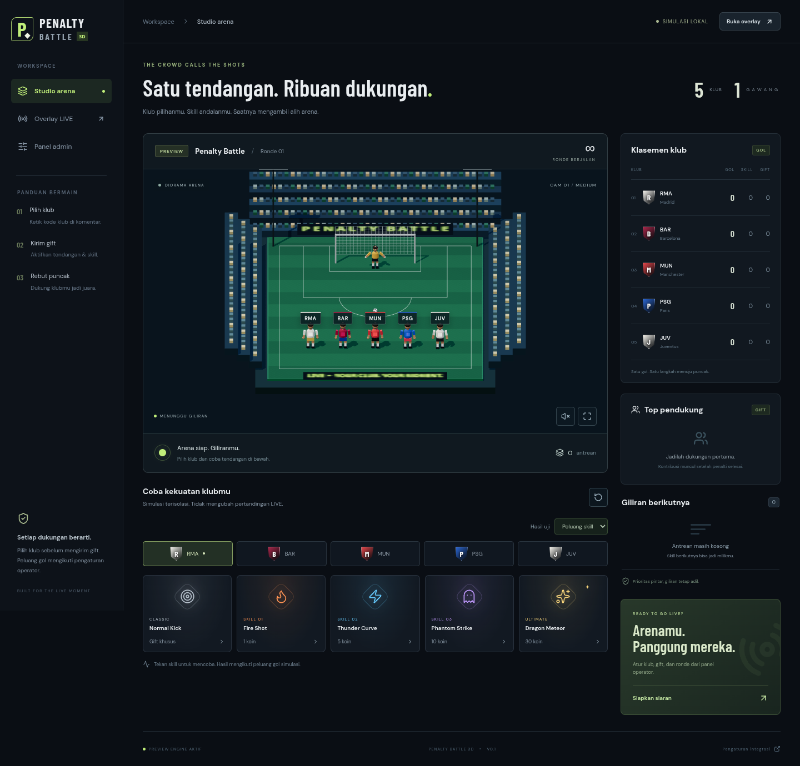

# Penalty Battle 3D

[](https://github.com/harvey-moeid/pen/actions/workflows/check.yml)

Arena penalti interaktif berbahasa Indonesia untuk TikTok LIVE, OBS, dan LIVE Studio. Implementasi awal [PRD v1.1](docs/PRD.md): **Workers + Durable Objects + KV + R2, tanpa D1**.

Lima karakter klub berjejer menghadap satu gawang. Pemain aktif berjalan ke titik penalti, menendang, bereaksi, dan kembali ke slot asal. Skill memiliki gerak dan efek berbeda: api, lintasan petir melengkung, putaran phantom, serta meteor naga emas. Semua aset bawaan dibuat secara prosedural; tidak menyertakan logo resmi atau model pemain berlisensi.



[Preview overlay portrait](docs/screenshots/portrait.png) · [Laporan browser](docs/browser-report.json)

## Jalankan lokal

Node.js **22.12+** (pengujian memakai Node 24).

```sh
npm ci
cp .dev.vars.example .dev.vars
# Isi dua secret acak yang berbeda, masing-masing minimal 32 karakter.
npm run build
npm run dev:server
# Terminal kedua:
npm run dev
```

- `http://localhost:5173/`: studio/simulator lokal yang terisolasi dari skor resmi.
- `/live`: overlay publik read-only dengan WebSocket dan pemulihan snapshot.
- `/admin`: login operator menggunakan `ADMIN_SECRET`; cookie HttpOnly, SameSite Strict, Secure di HTTPS.
- Semua halaman admin: integrasi, klub, gift, skill, kiper, ronde, antrean, leaderboard, visual, riwayat.
- `/admin/likes`: aktifkan like → Normal Kick dan tentukan ambang per penonton.
- `/admin/overlay`: atur tulisan, warna, ukuran, dan visibilitas overlay.

Pratinjau `/` juga berjalan tanpa backend setelah aset aplikasi dimuat. Pilih klub dan skill; dropdown **Hasil uji** dapat memaksa GOAL/SAVE/MISS untuk uji animasi. Tombol reset hanya mereset simulasi browser.

## Pemeriksaan

```sh
npm run check          # typecheck, lint promise, unit + integration tests, build
npm run format:check
npm run test:browser   # jalankan setelah build; membutuhkan Chromium
```

Tes browser memakai Worker, KV, R2, dan Durable Object **terisolasi**, dengan secret acak sementara. Tidak memakai kredensial atau pertandingan produksi. Jika Chromium belum tersedia, jalankan `npx playwright install chromium`; atau set `CHROMIUM_PATH` ke browser lokal. Screenshot dan laporan tersimpan di `artifacts/` (tidak masuk Git).

Tes meliputi combo final, prioritas mapping, peluang 0/100%, snapshot konfigurasi, pemisahan skor, anti-starvation, burst 500 aksi, penutupan ronde, pause/resume, retry bersamaan, restart runtime dengan storage persisten, WebSocket read-only, HMAC, auth/CSRF, serta upload R2.

## Gacha tanpa komentar klub

Di **Admin → Klub → Event tanpa komentar klub**, aktifkan **Gacha klub jika penonton belum memilih klub** untuk menerima gift/like sebelum komentar klub. Setiap tendangan diundi secara terpisah dari klub aktif dengan peluang sama; combo dapat memilih klub berbeda. Hasil undian tidak menjadi pilihan klub tetap. Komentar kode klub menetapkan klub untuk event berikutnya tanpa menunggu cooldown dari undian. Tendangan yang sudah mengantre tetap memakai hasil undiannya, termasuk setelah retry webhook atau restart. Overlay menandai tendangan tersebut dengan **GACHA** dan menyesuaikan petunjuk bawaan; tulisan khusus operator tetap dipertahankan.

Mode gacha awalnya **nonaktif**, termasuk untuk konfigurasi lama. Saat aktif, like penonton tanpa pilihan klub tetap dihitung per penonton dan baru mengundi ketika mencapai ambang; fitur like harus diaktifkan tersendiri. Perubahan mode gacha atau komentar pertama setelah gacha menghapus sisa like penonton gacha. Jika mode gacha dimatikan, event berikutnya dari penonton itu kembali memerlukan komentar klub.

## Koneklive baru

Webhook `/api/hooks/tiktok` juga menerima **koneklive Standard JSON** dengan header
`X-Webhook-Timestamp` / `X-Webhook-Signature`. Pilih event **comment, gift, like**
di koneklive dan samakan HMAC secret integrasi dengan `WEBHOOK_SIGNING_SECRET`
game melalui secret GitHub Actions sebelum CD. TEST diterima tanpa skor; combo
dihitung dari `delta_count`. Like gabungan tanpa identitas tidak dikreditkan.
Konektor lama tetap didukung. Lihat [kontrak dan pengaturan secret](docs/INTEGRATION.md#koneklive-standard-json).

## Like → tendangan normal (pengaturan)

Di **Admin → Like → tendangan**, aktifkan fitur dan isi **Jumlah like per tendangan normal** (1–1.000.000; nilai awal 100). Konfigurasi lama mendapat fitur dalam keadaan nonaktif agar deploy tidak mengubah aturan pertandingan yang sedang berjalan. Tambahkan event **like** pada daftar event webhook konektor, bersama **chat, gift, stream**.

Hitungan berlaku **per penonton**, untuk klub yang dipilih lewat komentar atau gacha jika mode tersebut aktif, hanya ketika ronde LIVE dan tidak dijeda. Dengan ambang 100, 250 like dari satu penonton menghasilkan 2 Normal Kick dan sisa 50. Like penonton berbeda tidak digabung. Sisa bertahan setelah reload/restart backend, dan direset ketika pindah klub, ronde baru/reset, atau pengaturan like berubah. Komentar ulang untuk klub yang sama tidak mereset hitungan.

Tendangan memakai peluang, poin saat gol, animasi, durasi, dan prioritas skill **NORMAL**. Skill harus aktif. Like tidak memerlukan Gift ID, tidak menambah poin gift, dan tetap melewati antrean serta dedup webhook. Saat kapasitas tidak cukup, seluruh event mendapat 503 tanpa menghabiskan sisa like; retry dengan ID sama dapat diterima setelah kapasitas tersedia. Petunjuk like otomatis tampil pada overlay saat fitur aktif.

Logo klub opsional dan memakai **PNG, WebP, atau JPG**, maksimal 20 MB. **GLB hanya untuk model karakter 3D** pengganti; tanpa GLB, karakter bawaan tetap tersedia.

Contoh siap unggah tersedia di **Admin → Klub → Contoh aset siap unggah**: [logo PNG](public/examples/logo-pb.png), [karakter GLB](public/examples/character-pb.glb), [pratinjau depan/belakang](public/examples/preview.png), dan [panduan aset](public/examples/PANDUAN-ASET.md). Model contoh hanya memakai clip `Idle`, sesuai loader saat ini; pemetaan otomatis Walk/Kick/Celebrate belum tersedia untuk model impor.

## Teks overlay

Di **Admin → Teks overlay → Penanda pemain & layar penuh**, pilih **Tulisan (kode klub)** atau **Logo klub** untuk penanda di atas kepala pemain. Logo memakai gambar dari menu Klub; klub tanpa logo atau dengan gambar gagal dimuat tetap menampilkan kode klub. Perubahan diterapkan ke overlay LIVE setelah disimpan.

Tombol layar penuh pada `/live` memiliki dua pilihan: **Semua overlay** (arena, skor, timer, dan petunjuk) atau **Arena saja (seperti sekarang)**. Pilih mode di sebelah ikon, lalu klik ikon untuk masuk; tekan Esc atau klik ikon lagi untuk keluar. Mode bawaan dapat disimpan di admin. Konfigurasi lama tetap memakai tulisan dan layar penuh arena saja.

Di **Admin → Teks overlay**, pilih satu dari 24 bagian tulisan: judul/subjudul, petunjuk, label arena, nama pendukung/skill saat tendangan, hasil ronde, klasemen, antrean, dan status. Isi maksimal 240 karakter per bagian, warna HEX, ukuran relatif 50–200%, serta sakelar tampil/sembunyikan. Isi kosong juga menyembunyikan bagian tersebut.

Pratinjau mengikuti draft; **Simpan perubahan** menerapkan teks ke overlay tersambung melalui WebSocket tanpa reload. **Pulihkan bagian ini** dan **Pulihkan semua teks dan tampilan** menyiapkan nilai bawaan sebagai draft sampai disimpan. Daftar kode klub, daftar gift/skill, koneksi, klasemen detail landscape, dan pemberitahuan dapat disembunyikan per kelompok. Nama klub/skill/gift tetap diatur di menu masing-masing.

Penanda dinamis mengikuti game: `{likes}`, `{queue}`, `{ranking}`, `{quality}`, `{actions}`, `{supporter}`, `{source}`, `{kick}`, `{winner}`, `{arenaStatus}`, `{connectorStatus}`, `{roundStatus}`, dan `{notice}`. Contoh: `Setiap {likes} like = 1 tendangan` atau `Antrean: {queue}`. Penanda yang tidak dikenal tetap tampil apa adanya; HTML ditampilkan sebagai teks biasa. Pengaturan ini hanya memengaruhi tampilan, tidak mengubah peluang, skor, antrean, atau sisa like.

Konfigurasi lama mendapat tulisan bawaan secara otomatis, tanpa menghapus state pertandingan. Screenshot editor tersedia di [pratinjau teks overlay](docs/screenshots/admin-overlay.png).

## CI GitHub Actions

[Verify Penalty Battle](https://github.com/harvey-moeid/pen/actions/workflows/check.yml) otomatis berjalan pada setiap push, pull request, dan merge queue. Untuk menjalankan ulang secara manual, buka **Actions → Verify Penalty Battle → Run workflow** dan pilih branch.

Tiga job berjalan paralel pada Ubuntu 24.04 dan Node.js 24, menggunakan `npm ci` dan cache npm:

| Job                        | Pemeriksaan                                                                    |
| -------------------------- | ------------------------------------------------------------------------------ |
| Code quality               | Sinkronisasi tipe Cloudflare, Prettier, TypeScript, ESLint                     |
| Unit and integration tests | Vitest untuk engine, adapter, dan runtime Worker; laporan JUnit                |
| Build and browser tests    | Build produksi, dry-run Wrangler, instalasi Chromium, tes studio/overlay/admin |

Job **CI passed** hanya berhasil jika ketiganya sukses; job gagal, dibatalkan, atau dilewati tidak dihitung lulus. Nama check ini dapat dipilih sebagai required status check pada ruleset branch `main`; workflow sendiri tidak mengaktifkan branch protection.

Laporan `test-results` dan screenshot/laporan `browser-verification` tersedia di bagian **Artifacts** pada run selama 14 hari. Upload tetap dicoba saat tes gagal, untuk menyimpan hasil yang sempat dibuat. Build yang telah diuji disimpan sebagai `production-assets` selama 7 hari. Run lama pada branch selain `main` dibatalkan ketika ada perubahan baru; deployment `main` yang sedang berjalan tidak diputus.

Job CI tidak membutuhkan secret produksi: tes memakai storage lokal terisolasi dan secret sementara. Setelah **CI passed**, job **Deploy production** otomatis berjalan hanya untuk push atau pemicu manual di `main`. Pull request dan merge queue hanya menjalankan pemeriksaan.

CD memakai artifact dari run yang sama, memasang secret runtime bersama versi Worker, lalu memeriksa health API, snapshot Durable Object, dan halaman `/live`. Deployment diserialkan dan commit lama yang sudah tertinggal dari `main` ditolak. Lihat [pengaturan empat secret GitHub dan resource produksi](docs/OPERATIONS.md#cd-github-actions).

## Arsitektur

```text
Konektor milik pengguna ── HMAC webhook ── Worker API
                                            │
                                   MatchRoom Durable Object
                                   SQLite internal, bukan D1
                                   state + antrean + dedup
                                   outcome + skor + outbox
                                      │              │
                                WebSocket       KV config/arsip
                                      │
                                Overlay / admin
                                      │
                               R2 aset immutable
```

- Seluruh perubahan game, dedup, hasil RNG, dan skor ditulis dalam transaksi sinkron SQLite **di Durable Object**.
- Alarm menyelesaikan aksi meskipun browser tidak tersambung; reload tidak menghitung skor ulang.
- Peluang, durasi, kontribusi, poin skill, klub, dan versi konfigurasi disnapshot ketika enqueue. Outcome diputuskan dengan Web Crypto di server saat aksi dimulai.
- Catatan `ACTIVE`/`DONE` tiap tendangan resmi disimpan untuk audit. Demo tidak masuk skor atau riwayat resmi.
- KV ditulis saat konfigurasi berubah atau ronde selesai melalui outbox persisten, bukan per gift/like. Konfigurasi KV tidak kedaluwarsa; arsip hasil mengikuti retensi.
- Score publik tidak menyertakan ID penonton, secret, isi konfigurasi admin, atau audit.

Lihat [arsitektur dan aturan](docs/ARCHITECTURE.md), [audit konektor](docs/INTEGRATION.md), [runbook](docs/OPERATIONS.md), dan [status acceptance](docs/ACCEPTANCE.md).

## Deploy Cloudflare

```sh
npx wrangler login
npx wrangler secret put ADMIN_SECRET
npx wrangler secret put WEBHOOK_SIGNING_SECRET
npm run build
npx wrangler deploy --dry-run
npm run deploy
```

`wrangler.jsonc` menyertakan migrasi SQLite Durable Object, static SPA assets, observability, KV, R2, dan deklarasi secret yang diperlukan. Namespace KV `penalty-battle-3d-CONFIG` dan bucket `penalty-battle-assets` telah disiapkan di akun Cloudflare `harvey`. Gunakan akun tersebut untuk deploy; untuk akun lain, provision resource baru dan perbarui binding serta konfigurasi CD terlebih dahulu. CD dapat melakukan deploy pertama dengan empat secret GitHub, tanpa perintah lokal di atas.

Setelah deploy, login admin, kosongkan **Filter Room ID TikTok** untuk konektor dengan signing secret khusus (atau isi ID siaran yang benar jika perlu pembatasan), pilih **Gift ID Normal** untuk pemicu gift atau aktifkan pemicu like, periksa mapping/kontribusi/probabilitas, lalu simpan dan mulai ronde. Tambahkan endpoint `/api/hooks/tiktok` pada dashboard konektor untuk event **chat, gift, like, stream**. Secret tidak boleh dimasukkan ke URL overlay atau source frontend.

**Status produksi:** kode konektor telah diaudit pada commit `3660b385078318e2d10782ddf1e00dc8492d3b28`. Pengujian memakai payload kontrak dan HMAC nyata di runtime lokal, belum delivery TikTok LIVE sungguhan. ID pesan upstream belum diteruskan konektor dan delivery retry-nya belum durable; kedua batas tersebut perlu ditangani/diterima sebelum siaran publik berbayar. FPS di perangkat OBS/LIVE Studio dan aset GLB final juga harus diuji. Jangan mengartikan simulator atau tes sintetis sebagai bukti kesiapan produksi penuh.
